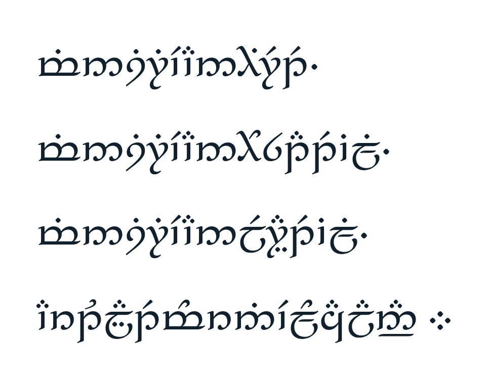

# Ring inscription

The owner's Quenya verse between the rings of the mark on plyn.one: the One Ring verse turned round – one Flow (Sirië, Plyń) that finds them, gathers them all, frees them all and leads them from darkness to light.

## Latin letters, as the owner wrote it

Min Sirië, an hirë te, Min Sirië, an hosta te illi, Min Sirië, an lerya te illi, Ar tulya te morniello calanna.

## Lines, as written on the ring

Min Sirië an hirë te ·
Min Sirië an hosta te illi ·
Min Sirië an lerya te illi ·
Ar tulya te morniello calanna ::

As on the One Ring: words run together without spaces, each poetic line ends in a low pusta and a space, a quadruple pusta (::) marks where the end meets the start.

## Tengwar

- `tengwar.txt` – the inscription as text, the source the page is built from (tools/build.py puts it in place of `<!--inscription-->`). Its signs are Private Use Area code points of the Free Tengwar mapping and show only in a Tengwar font such as Alcarin Tengwar.
- Transcribed word by word with Glaemscribe, mode quenya (classical): `glaemscribe.transcribe(word, mode="quenya")`, words joined without spaces, U+E060 (pusta) after each of the first three lines, U+E063 (quadruple pusta) at the end.
- Font: Alcarin Tengwar (OFL, ../fonts/OFL-Alcarin-Tengwar.txt), subset to these signs: `pyftsubset AlcarinTengwar-Regular.otf --text-file=inscription/tengwar.txt --layout-features=* --flavor=woff2 --output-file=fonts/alcarin-ring.woff2`.
